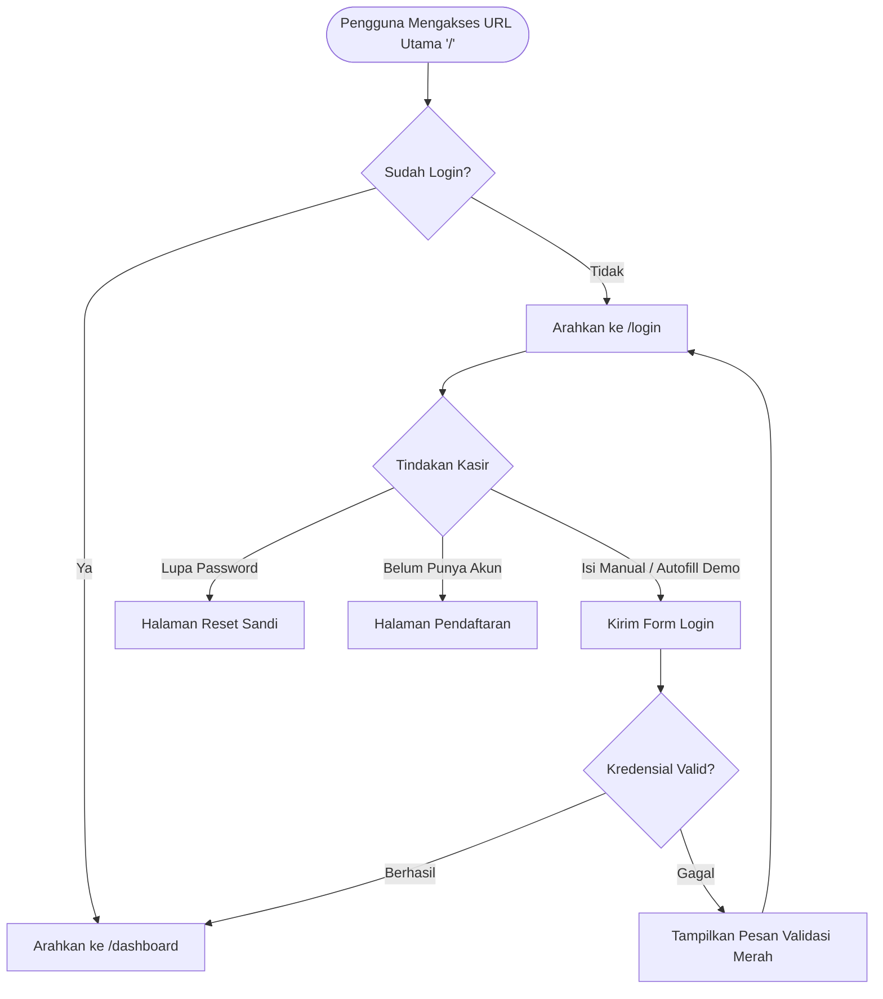

# PRD: Redesain Halaman Login & Penataan Root Route (`/`)

| Metadata | Keterangan |
| :--- | :--- |
| **Proyek** | Kasir Sederhana (Point of Sale & Inventory) |
| **Fitur** | Otentikasi Kasir & Routing Halaman Utama |
| **Dokumen** | Product Requirement Document (PRD) & Design Spec |
| **Status** | Selesai Diimplementasikan (`Implemented`) |
| **Target Pengguna** | Kasir Toko, Pengelola Inventaris, Developer/Tester |

---

## 1. Latar Belakang & Ringkasan Masalah

Pada versi awal instalasi Laravel dan Laravel Breeze:
1. **Route `/` Tidak Relevan:** Route `/` masih me-render `view('welcome')` standar Laravel yang berisikan dokumentasi ekosistem Laravel. Karena aplikasi ini adalah sistem kasir internal (POS), halaman sambutan publik tersebut membingungkan pengguna dan tidak memiliki nilai operasional.
2. **Inkonsistensi Tampilan Antarmuka (UI/UX):** Halaman login dan layout `guest` bawaan Breeze menggunakan gaya visual default (logo kotak Laravel, background abu-abu `gray-100`, tombol `gray-800`). Sementara itu, aplikasi utama sudah memiliki tema desain yang rapi dengan nuansa warna **Indigo**, **Slate**, font **Figtree**, dan kartu dengan *rounded corners*.
3. **Kebutuhan Pengujian Cepat:** Pengembang dan penguji memerlukan kredensial akun kasir secara praktis tanpa harus membuka database seeder secara manual setiap kali sesi kedaluwarsa.

---

## 2. Tujuan & Sasaran (Goals & Non-Goals)

### Goals
- **Smart Redirect pada Root Route:** Mengalihkan pengunjung yang belum login langsung ke `/login`, dan pengguna yang sudah terotentikasi langsung ke `/dashboard`.
- **Keseragaman Desain (Design Cohesion):** Menyelaraskan seluruh elemen otentikasi (`layouts/guest`, `auth/login`, `auth/register`, `auth/forgot-password`) agar identik dengan desain antarmuka dashboard dan kasir.
- **Micro-interactions yang Ramah Pengguna:**
  - Toggle lihat/sembunyikan kata sandi (show/hide password) menggunakan Alpine.js.
  - Kartu helper akun demo dengan tombol *1-click auto-fill* kredensial seeder (`test@example.com` / `password`).
  - Efek transisi halus pada tombol login (`active:scale-[0.99]`).

### Non-Goals
- Tidak mengubah alur otentikasi inti bawaan Breeze (controller otentikasi tetap menggunakan `AuthenticatedSessionController`).
- Tidak mengubah struktur database pengguna (tabel `users` tetap standar).

---

## 3. Alur Pengguna (User Journey)



---

## 4. Spesifikasi Perubahan Teknis

### 4.1. Routing ([`src/routes/web.php`](file:///home/xylo/Documents/adit/devbox/belajar-laravel/kasir-sederhana/src/routes/web.php))
Route root `/` diperbarui dari:
```php
// SEBELUM:
Route::get('/', function () {
    return view('welcome');
});
```
Menjadi:
```php
// SESUDAH:
Route::get('/', function () {
    return auth()->check()
        ? redirect()->route('dashboard')
        : redirect()->route('login');
});
```

### 4.2. Berkas yang Diperbarui

| Berkas | Perubahan Utama |
| :--- | :--- |
| [`src/routes/web.php`](file:///home/xylo/Documents/adit/devbox/belajar-laravel/kasir-sederhana/src/routes/web.php) | Mengganti route `/` menjadi pengalihan cerdas berbasis status login. |
| [`src/resources/views/layouts/guest.blade.php`](file:///home/xylo/Documents/adit/devbox/belajar-laravel/kasir-sederhana/src/resources/views/layouts/guest.blade.php) | Memasang brand header Kasir Sederhana (ikon keranjang kasir indigo), ambient glow lembut, background `bg-slate-50`, dan kartu `rounded-2xl border-slate-200/90`. |
| [`src/resources/views/auth/login.blade.php`](file:///home/xylo/Documents/adit/devbox/belajar-laravel/kasir-sederhana/src/resources/views/auth/login.blade.php) | Redesain formulir dengan input modern, toggle lihat kata sandi (Alpine.js), tombol login full-width dengan ikon panah, dan kotak helper akun demo. |
| [`src/resources/views/auth/register.blade.php`](file:///home/xylo/Documents/adit/devbox/belajar-laravel/kasir-sederhana/src/resources/views/auth/register.blade.php) | Penyesuaian formulir daftar akun baru dengan gaya token Slate-Indigo yang seragam. |
| [`src/resources/views/auth/forgot-password.blade.php`](file:///home/xylo/Documents/adit/devbox/belajar-laravel/kasir-sederhana/src/resources/views/auth/forgot-password.blade.php) | Penyesuaian formulir permintaan reset sandi dalam Bahasa Indonesia. |
| [`src/resources/views/components/primary-button.blade.php`](file:///home/xylo/Documents/adit/devbox/belajar-laravel/kasir-sederhana/src/resources/views/components/primary-button.blade.php) | Mengganti warna dasar tombol dari abu-abu netral (`bg-gray-800`) ke Indigo (`bg-indigo-600 hover:bg-indigo-700`). |

---

## 5. Panduan Desain & Design Tokens

### Palet Warna
- **Primary Brand:** `Indigo 600` (`#4f46e5`) untuk tombol aksi utama, fokus input, dan ikon merek.
- **Primary Hover/Active:** `Indigo 700` (`#4338ca`) dan `Indigo 800` (`#3730a3`).
- **Brand Glow/Tint:** `Indigo 50` (`#eef2ff`) & `Indigo 100` (`#e0e7ff`).
- **Background Utama:** `Slate 50` (`#f8fafc`).
- **Permukaan Kartu:** Putih murni (`#ffffff`) dengan pembatas `border-slate-200/90`.
- **Tipografi Utama:** `Slate 900` (`#0f172a`) untuk judul, `Slate 700` untuk label, dan `Slate 500` untuk teks keterangan.
- **Status & Error:** `Red 500` (`#ef4444`) untuk pesan validasi dan batas input bermasalah.

### Tipografi & Komponen
- **Font Family:** `Figtree`, sans-serif.
- **Card Styling:** `rounded-2xl`, `border border-slate-200/90`, `shadow-xl shadow-slate-900/5`.
- **Form Controls:** `rounded-xl`, `border-slate-300`, padding `px-3.5 py-2.5`, focus ring `focus:ring-2 focus:ring-indigo-500/20`.

---

## 6. Kriteria Penerimaan (Acceptance Criteria)

- [x] **AC-1:** Mengunjungi URL `/` saat belum login langsung diarahkan ke `/login`.
- [x] **AC-2:** Mengunjungi URL `/` saat sudah login langsung diarahkan ke `/dashboard`.
- [x] **AC-3:** Halaman login menampilkan identitas merek "Kasir Sederhana" beserta ikon keranjang belanja kasir.
- [x] **AC-4:** Pengguna dapat menekan ikon mata untuk melihat atau menyembunyikan input kata sandi tanpa memicu pengiriman form.
- [x] **AC-5:** Tombol "Isi Otomatis" pada kartu akun demo berhasil mengisi input email dengan `test@example.com` dan kata sandi dengan `password`.
- [x] **AC-6:** Tautan "Lupa kata sandi?" dan "Daftar akun kasir baru" berfungsi dan mengarah ke rute yang sesuai dengan tampilan seragam.
- [x] **AC-7:** Tampilan antarmuka responsif dan terlihat proporsional baik pada layar ponsel cerdas, tablet, maupun monitor desktop.

---

## 7. Rencana Verifikasi & Pengujian

1. **Uji Pengalihan Route:**
   - Jalankan browser atau `curl -I http://localhost/` $\rightarrow$ pastikan respons berstatus HTTP `302 Found` menuju `/login`.
2. **Uji Autentikasi:**
   - Masukkan `test@example.com` dan `password` $\rightarrow$ pastikan berhasil masuk ke `/dashboard`.
   - Kembali ke URL `/` $\rightarrow$ pastikan otomatis dialihkan ke `/dashboard` (bukan login lagi).
3. **Uji Validasi Form:**
   - Masukkan email salah atau kosongkan kata sandi $\rightarrow$ pastikan muncul pesan kesalahan dengan border merah dan format teks rapi.
